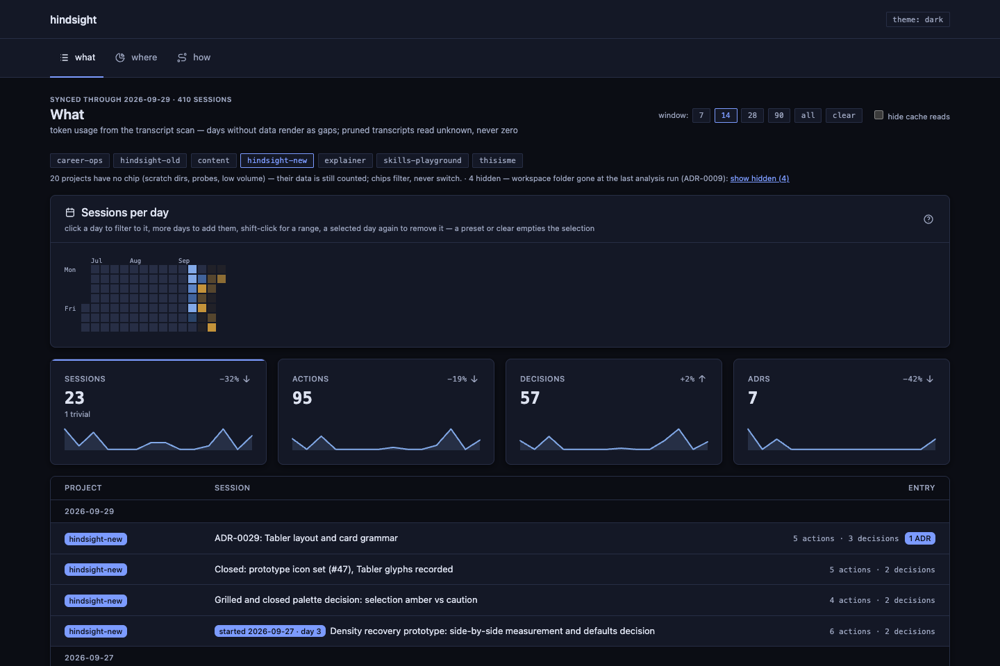
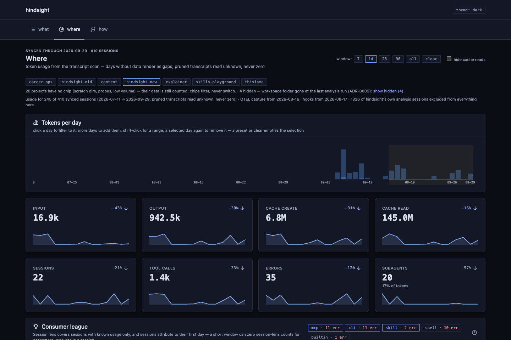
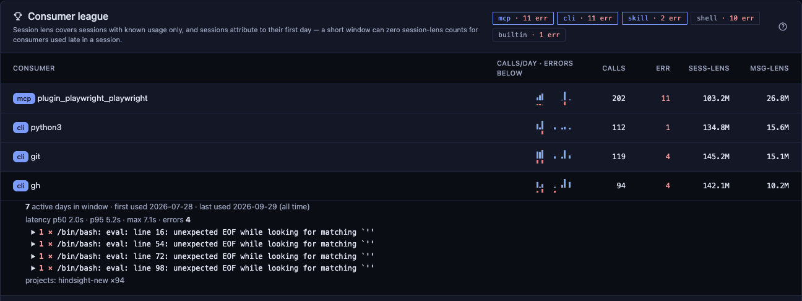
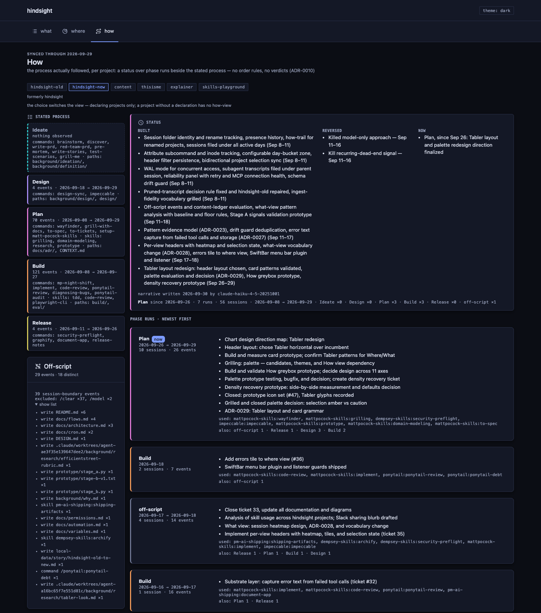
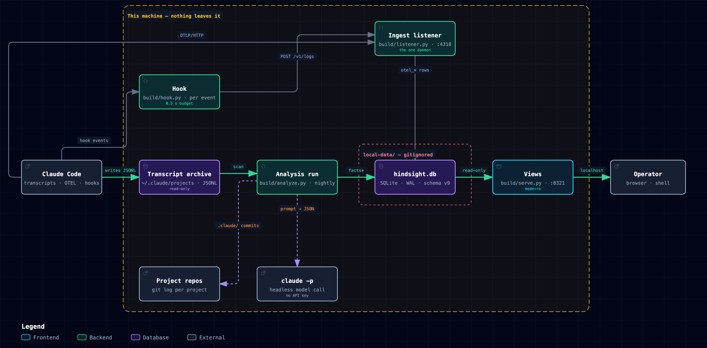

# Hindsight

Local observability over Claude Code history, built for a solo, skill-heavy operator: **what** was done, **where** the tokens went, and **how** the process ran. Read-only, stdlib-only Python over SQLite — everything is derived from the transcripts and telemetry already on the machine. Hindsight keeps every copy on the machine; data reaches Anthropic only through Claude sessions you run ([ADR-0042](docs/adr/0042-the-local-only-rule-forbids-a-second-store-not-the-api.md)).

**What — the cross-project session ledger.** One row per session: what was done and what was decided, setup changes, with the evidence a click away.



**Where — the token dashboard.** Cache economics, consumer league (skills / MCP / CLI), models and latency, reliability, and the sunk cost every session pays at start.



Every error count in the league has the errors behind it. Opening a consumer's row lists them grouped by their error line, count-first, with the verbatim text and the session behind each occurrence one click away; a category chip carries its in-window error count whether it is on or off, so a switched-off category's errors are stated, never silent. An error whose transcript was pruned before capture is counted and read as *text not captured* — unknown is never zero.



**How — the process trail.** One project's declared process beside what actually happened: phase runs, a model-written current-state card (what stands, what was superseded, what is next, each line traceable to a run or an ADR), and the mechanical trail behind it. The declared process is the project's root `local-process.md` if it has one, else the house master named under `## Process` in `~/.claude/CLAUDE.md`. Work that matches no declared stage is off-script, and it is shown rather than hidden: listed beside the stated process, tallied on every run, and forming runs of its own when nothing declared was going on.



## What it is for

Three questions about a heavy Claude Code setup that nothing on disk answers directly: where the tokens went, what was actually done, and how you followed your general process, or didn't. Hindsight answers them from the transcripts and telemetry already on the machine — no account, no upload, no daemon beyond an optional listener. The audience is you, reviewing your own history, and the product is built to that bar.

Everything runs on the operator's machine and nothing leaves it: Claude Code writes the transcripts, an analysis run reads them and calls the `claude` CLI for the model pass, and the views read the resulting database on localhost.



Why it exists, who reads this repo, how it was built and what was reversed along the way: [background/why.md](background/why.md). The full working record ships with the code — [88 tickets](background/tickets/), the phase documents under [background/](background/), the forty-one decision records in [docs/adr/](docs/adr/), the reviewability docs in [docs/](docs/architecture.md), and the domain vocabulary in [CONTEXT.md](CONTEXT.md).

## Run it

macOS is assumed throughout, and stated rather than worked around — the background pieces are launchd jobs, and nothing else has been written. Requirements: `python3` (3.9+ verified; stdlib only, so no pip and no venv) and the `claude` CLI on PATH. Hindsight ships as a Claude Code plugin; the repo is its own marketplace (ADR-0036). The v1 clone-and-run route was proven on a clean environment before publication; the plugin route below has not yet had that run.

1. **Install.** In Claude Code, `/plugin marketplace add dempseydata/hindsight`, then `/plugin install hindsight@hindsight`. Then `/hindsight:ops install` — it points `~/.hindsight/current` at the installed plugin and writes both launchd jobs (the ingest listener and the nightly analysis) against it, with the interpreter it ran under. It is idempotent, and replaces v1's plists in place. Everything that must outlive a plugin update lives in **Hindsight home**, `~/.hindsight/` (`HINDSIGHT_HOME` overrides): the database, the logs and `current`. Nothing deletes it — `/hindsight:ops uninstall` removes the jobs and `current` and prints the one manual command that would. Coming from v1: `/hindsight:ops install --from <v1 clone>/local-data/hindsight.db` moves the database in once, and refuses if one is already there; it also lists the v1 hook entries to delete from `~/.claude/settings.json`, which it never edits.
2. **Analyse.** The nightly runs at 03:00. To run it now: `python3 ~/.hindsight/current/cli/analyze.py` — it creates the database if needed, syncs every transcript under `~/.claude/projects`, and runs the model pass over them. With no transcripts at all it completes cleanly (exit 0). The first run is also the backfill: months of existing history go through the same pipeline, so it may hit your subscription's usage limits and pause — limit exhaustion is a designed state, not a failure: unfinished sessions stay pending and the next run resumes where it left off. A session whose newest record was captured in the last five minutes is live, and its model pass waits for a later run; if `claude` is not resolvable, model calls take the same designed pause — one stderr line, exit 0, the mechanical scans still land.
3. **Serve.** `/hindsight:ops open` starts the views server if it is not answering and opens `http://127.0.0.1:8321/what` (`serve` starts it without opening). Read-only, bound to localhost, on-demand: no job, gone at logout, its log in `~/.hindsight/logs/serve.log`. Run before step 2 it refuses with `no database at <path> — run an analysis first`, and that is by design — a listener-only database gets the same answer.

Working from a clone instead, `python3 cli/analyze.py` and `python3 cli/serve.py` run the same code against the same Hindsight home.

Everything else is optional and on-demand, and its absence degrades to honesty rather than a crash — the coverage window: OTEL-fed cards state when continuous capture began instead of presenting the gap as a zero.

- **Ingest listener.** The launchd agent `com.hindsight.ingest`, written by `/hindsight:ops install` (`start` and `stop` control it), receives OTEL telemetry on `127.0.0.1:4318`. It takes `application/json` only and caps a body at 8 MiB — the loopback bind keeps other machines out, and the content-type check keeps out a web page you happen to visit, which could otherwise post a cross-origin form body at it without a preflight (#34). Both servers also refuse a `Host` header that does not name loopback, which keeps out a page that rebinds its own domain to `127.0.0.1`. No authentication beyond that: the trust boundary is the machine. Claude Code emits nothing until told to — the env block for `~/.claude/settings.json`, verified live against a real session during the definition phase:

  ```json
  "env": {
    "CLAUDE_CODE_ENABLE_TELEMETRY": "1",
    "OTEL_LOGS_EXPORTER": "otlp",
    "OTEL_METRICS_EXPORTER": "otlp",
    "OTEL_EXPORTER_OTLP_PROTOCOL": "http/json",
    "OTEL_EXPORTER_OTLP_ENDPOINT": "http://127.0.0.1:4318",
    "OTEL_LOG_TOOL_DETAILS": "1"
  }
  ```

- **Capture hook.** The plugin registers `cli/capture.py`, async, on `SessionStart`, `Stop` and `SubagentStop` (ADR-0033): each turn it appends the transcript's new complete lines, verbatim, to the raw store in the database; at `SessionStart` it records the workspace folder's identity (ADR-0018), so a renamed folder keeps its history. It writes straight to SQLite and never needs the listener. The v1 self-instrumentation hook and its `hindsight.hook` event are retired.
- **Health check.** The plugin registers `cli/health.py`, synchronous, on `SessionStart` (ADR-0036). It is silent when collection is healthy. Otherwise it shows you one line, never the model, naming the source and how long: a source failing since its first error, capture behind OTel for a session, or `not installed — run /hindsight:ops install`. After a plugin update it re-points `~/.hindsight/current` at the new version and restarts the listener, so an update needs no re-install. Sessions already open when the plugin updates keep the old hooks until Claude Code restarts, and the health line says so (capture behind OTel).
- **Nightly analysis.** The launchd calendar job `com.hindsight.nightly`, written by `/hindsight:ops install`, runs the analysis daily at 03:00 (launchd runs it on wake if the Mac was asleep, skips it if powered off), logging to `~/.hindsight/logs/analyze.log`. It installs a real launchd job, so it was verified by code reading and a stubbed `launchctl` only.
- **Attribute pre-hook history.** A project is its folder, not its name (ADR-0018): with the hook installed, a rename keeps a project's history together. Sessions that predate the hook carry no folder identity and keep the name they were synced under, so after renaming a folder, stamp them once: `python3 cli/analyze.py attribute <synced-name> <folder> [--before <ISO-8601>]`. It refuses a folder that does not exist or lies outside the workspace root, prints how many sessions it stamped, never overwrites a session that already has an identity, and does not itself re-key — the next analysis run files them under the folder's current name. `--before` bounds it to sessions whose first transcript record precedes that instant, for a name that was later reused by a different folder; a session whose transcript has been pruned is decided by its stored day when that day is strictly before the bound's, and left alone on the bound's own day — so in a two-call repair it lands wherever the second, unbounded call points; check the ledger for that day first.
- **Schema-drift guard.** The transcript format is an unversioned dependency (ADR-0020). Each run compares the shape of the newest record version with the last, against the field contract at the top of [cli/substrate.py](cli/substrate.py); a change is a *breakage* banner on every view (red when the rows since may be thin, blue when upstream merely added a key) and, from the command line, a macOS notification for the red kind. Ingest never halts on it. `python3 cli/analyze.py acknowledge-breakage <id>` closes a row and makes its version the comparison baseline; it never rescans — a parser fix is a code change plus a schema bump.

**Hard-wired to the author's Mac** — every machine-specific assumption a second user would have to change:

- `~/Documents/Claude`, one directory per project repo, is the assumed workspace layout (`--projects-dir` overrides). Sunk-cost workspace scanning and project-presence observation read it; when absent, both skip silently.
- `~/.claude` is assumed as Claude Code's home: transcripts under `~/.claude/projects` (`--root` overrides), the config-snapshot surface at `~/.claude` itself (`--claude-dir`).
- The model pin is `claude-haiku-4-5-20251001`, called through `claude -p` — your subscription needs that model available.
- Ports `4318` (listener — keep it matching the `OTEL_EXPORTER_OTLP_ENDPOINT` env var) and `8321` (serve) are defaults, each overridable with `--port`.
- Day buckets follow the Mac's clock zone. `HINDSIGHT_TZ=America/New_York` (any IANA name) pins them to a zone instead — for a travelling laptop, or a "my day" that is not the machine's; export it in the shell that runs `serve.py`, and before `/hindsight:ops install` so the nightly carries it. An unknown name warns once and uses the host zone. Charts and the ledger re-bucket on the next reload — the ledger files each session under the days its usage fell on, so it never sits a day off its bars; only a continuation note's *started* day waits for the next analysis run to catch up.
- Both launchd plists bake install-time absolutes: the installing Python's path in both, run against `~/.hindsight/current`, and the installing shell's PATH (and `HINDSIGHT_TZ`, `HINDSIGHT_HOME`, `HINDSIGHT_RAW_DAYS` and the plugin data directory, if set) in the nightly one — launchd's default PATH lacks `claude`, which is exactly the failure mode the step-2 pause exists for. Re-run `/hindsight:ops install` after changing Python or any of those variables; a plugin update alone is handled by the health check.

**Privacy.** The database holds your transcripts themselves: the capture hook stores every transcript line verbatim in the raw store (ADR-0031), tool inputs and results included. A session's raw records are kept for 90 days from its newest record (`HINDSIGHT_RAW_DAYS` changes that; `0` keeps them forever), then compacted away once fully derived (ADR-0034). Beside them sit the derived rows: conversational extracts, model-written audit entries and status cards, content-addressed snapshots of your `~/.claude` config surface, and the result text of failed tool calls (ADR-0027). The database lives in Hindsight home and the extract cache in the plugin data directory (`local-data/`, gitignored, from a clone); none of it leaves the machine; the server is read-only and binds `127.0.0.1`. The one outbound path is the analysis itself: session extracts go to the model through your own `claude` CLI — the same account and the same trust boundary as the sessions that produced them. Those calls run with no tools, no MCP servers and your hooks disabled, from a temporary directory rather than any repo.

**Deferred, deliberately.** No installer, no `uvx`, no Linux/systemd port. The stated demand is one user, so the manual path is documented instead of automated: documentation costs a reader minutes, an installer costs standing maintenance against a moving Claude Code. Both are cheap to reverse the day a real second user appears.

## License

[MIT](LICENSE). The interface glyphs are derived from [Tabler Icons](https://tabler.io/icons) (MIT, © 2020–2026 Paweł Kuna); its licence is in [LICENSES/tabler-icons.txt](LICENSES/tabler-icons.txt).
