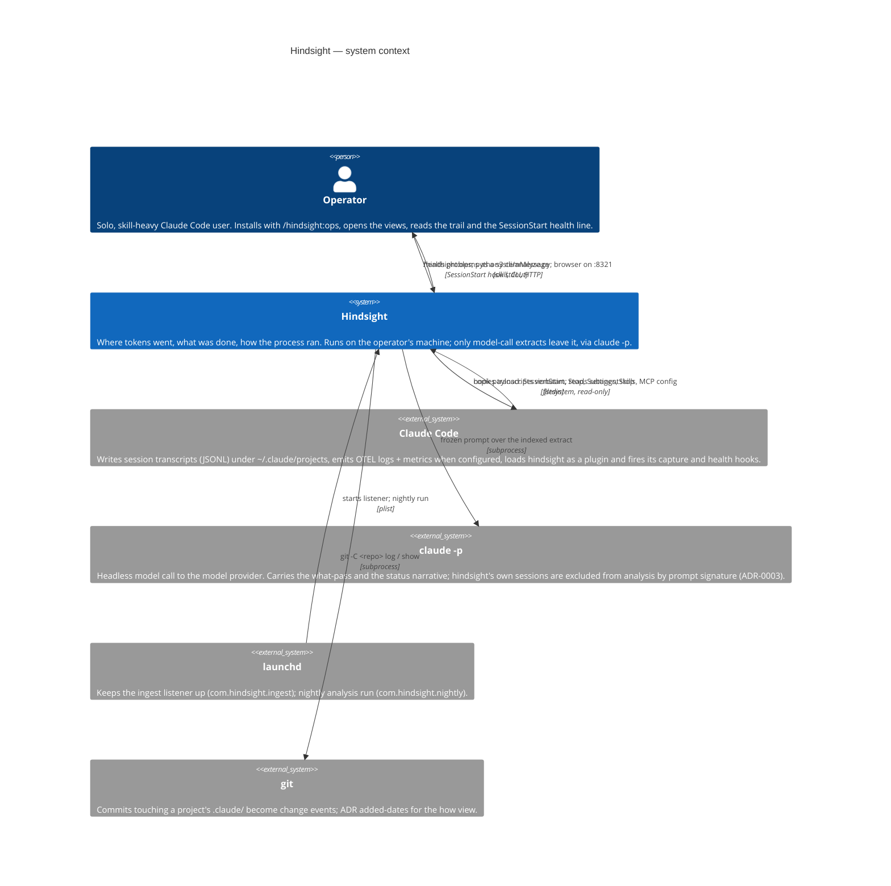
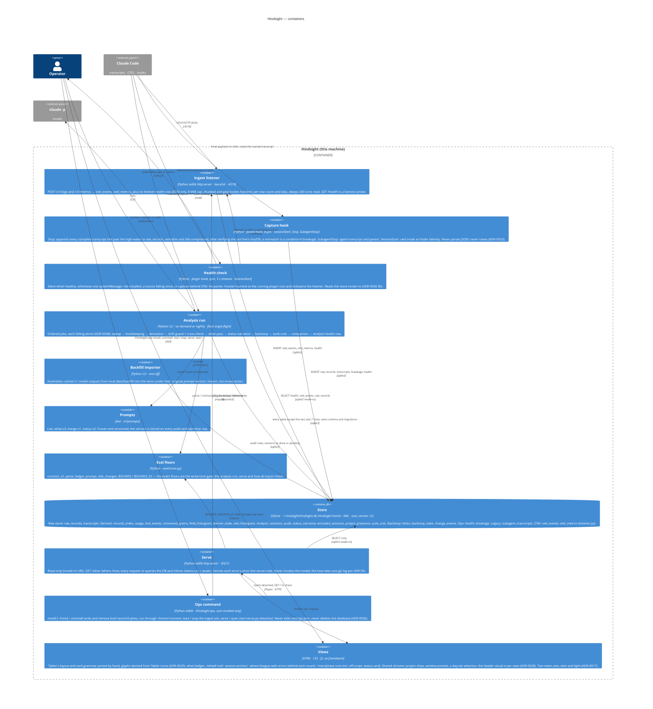
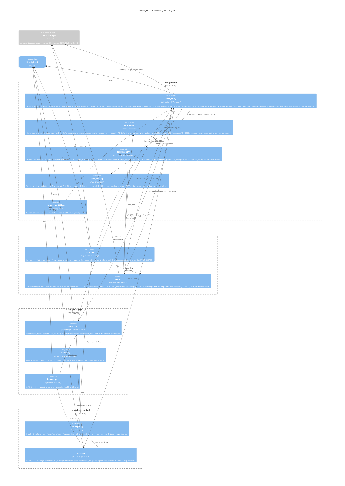

# Architecture — C4

Local observability over Claude Code history for one operator. Three levels: who and what
it talks to, the runnable pieces and the store between them, and the Python modules behind
the hooks, the analysis run and the server.

**Basis:** the code in `cli/` at schema version 12 (`PRAGMA user_version`, `analyze.init_db`),
plugin version 2.1.0, module docstrings, and ADR-0001 → 0041. Where this document and the code
disagree, the code is right; re-derive when a module is added, split, or gains a cross-directory
import. Vocabulary is in [CONTEXT.md](../CONTEXT.md); each decision cited below is in [adr/](adr/).

**Key assumptions the whole design rests on:** one operator, one macOS machine, one Unix user
(launchd domain `gui/<uid>`, `home.py:15-16`); transcripts under `~/.claude/projects/**/*.jsonl`
are append-only, and the raw store copies them as they grow; the model is reachable only as the
`claude` CLI on `PATH`; Hindsight opens no outbound connection of its own — the only data that
leaves the machine is the extract it hands `claude -p`, which goes to the model provider under
the operator's own subscription.

## L1 — System context

Mermaid source (text form, for agents and diffs)

- **No daemon beyond the listener.** ADR-0001 (as amended): the ingest listener is the one sanctioned background process. The hooks are per-event processes, the nightly is a scheduled invocation of the on-demand run, and the views server is started to look and closed when done.
- **The model is a subprocess, not a service.** No API key, no SDK — `claude -p` on PATH, serial, one call at a time, with no tools, no MCP, hooks disabled and an empty cwd (`analyze.py:1625-1656`). Missing CLI or a usage limit pauses the run rather than crashing it.
- **Nothing is written back to Claude Code.** Transcripts and config are read; the hooks' only output is the health check's `systemMessage` line, shown to the operator, never to the model.
- **Three views, not four.** The so-what view (ADR-0021 → 0025) was designed and then dropped after its dry run (ADR-0026). Nothing of it exists in `cli/` or `eval/`. CONTEXT.md keeps its terms as history only.

## L2 — Containers

The picture is an [Archify](https://github.com/tt-a1i/archify) export (SVG · Auto, follows light/dark) of [diagrams/architecture.archify.json](diagrams/architecture.archify.json), checked against the code with source evidence pinned to a commit (`meta.repository.revision`). The nightly sweep, backstop, sunk-cost scans, logs and the `current` symlink are on its side cards, not drawn. Re-derive it when a container is added or removed: `archify finalize architecture docs/diagrams/architecture.archify.json <out.html> --repo-root . --quality showcase`, then Export → SVG · Auto. The interactive HTML is not committed. The Mermaid below is the same view in text form.

Mermaid source (text form, for agents and diffs)

- **Write and read never share a process.** Capture, ingest and analysis write; serve and the health check open the DB read-only and serve has no run button (ADR-0008). Refresh is a browser reload.
- **Three ingest paths, one store.** Transcript lines arrive through the capture hook on Stop, with the run's sweep as the catch-up for a missed firing (`analyze.py:759-782`); OTEL arrives live through the listener; derivation then parses the raw store, never the files (ADR-0031). The where view joins OTEL and derived rows.
- **Single-flight analysis.** `run_analysis` takes a non-blocking `flock` on `analysis.lock` beside the DB; a second run (manual during the nightly) prints one line and exits (`analyze.py:2000-2010`). Each job's failure rolls back, is logged, and lands in the `analysis` health row (`analyze.py:2019-2025`, `2103-2104`), which the health check reports at the next SessionStart.
- **`eval/` is a runtime dependency, not just a test suite.** `analyze.py` puts `eval/` on `sys.path` and imports `score` (`analyze.py:223-224`); `serve.py:75` and `how.py:53` import from it on the back of that path insert. The capture hook imports `analyze.init_db` (`capture.py:200`), so it loads `eval/score.py` too. These are the only cross-directory imports.
- **The design contract is inlined, not linked.** `design/tokens.css` is read by serve at render time (`serve.py:849`), so a token edit shows on next reload with no build step.
- **Schema and migrations live in one place.** `SCHEMA` plus the `user_version`-gated steps in `analyze.init_db` (`analyze.py:410-554`). v10 adds the raw store, registry, records index, deriver state, health and OTel histogram tables, then switches to incremental auto-vacuum with a full `VACUUM` (`_migrate_v10`, `analyze.py:651-671`); v11 drops `audit.date`; v12 drops `scan_runs`. The listener creates only its two `otel_*` tables (`listener.py:34-61`). Because the capture hook opens the store through `init_db`, a hook firing can be the process that migrates it.

## L3 — Components: the `cli/` Python modules

Mermaid source (text form, for agents and diffs)

- **Import direction is enforced by design, not tooling.** `substrate.py`, `sunk_cost.py` and `home.py` are leaves: others import them, never the reverse. Substrate's one `cli/` import is `FILE_TOOLS` from extract. `analyze` ↔ `how` and `analyze` ↔ `capture` are cycles broken by late imports (`analyze.py:1587`, `capture.py:200`).
- **The hooks stay cheap until they know the payload is theirs.** `capture.py` exits on a bad event name or a path not ending `.jsonl` before importing `analyze` (`capture.py:197-200`); `health.py` imports only `home` and the stdlib, and quotes its `mode=ro` URI by hand to avoid `urllib.request`'s import cost (`health.py:26`).
- **`analyze.py` is the god module.** 66 functions, 2,199 lines: the schema and every migration, the sweep, the derivers' driver, the drift guard and cross-check, the model call, the narrative, the backstop, compaction and two subcommands. Serve and how both reach into it for day bucketing and paths, and the capture hook for `init_db`. The day helpers and the schema remain the two obvious seams if a split is ever wanted.
- **Prompts and assets are data.** `cli/prompts/*.txt` and `cli/assets/*` are read at run time; no module owns them beyond the path constant.
- **The error line is a view concern.** `serve.error_line` (`serve.py:539-552`) derives the grouping key from stored `error_text` at render; the browser (`where.js:150-170`) only groups and renders. Tuning the rules never costs a rescan (ADR-0027 §3).
- **Project names come from the transcript directory.** `project_name` strips the dash-encoded form of the workspace folder (`DEFAULT_PROJECTS_DIR`, default `~/Documents/Claude`) from the directory name; a directory outside it keeps its full encoded name (`analyze.py:716-719`). `sync_sessions` calls it without `--projects-dir` (`analyze.py:809`), so that flag does not move the prefix.

## Stack

| Layer | Choice | Where |
| --- | --- | --- |
| Language | Python 3 stdlib only — no pip dependencies (ADR-0003) | `cli/*.py`, `eval/*.py` |
| Store | SQLite, one file `hindsight.db` in Hindsight home (`~/.hindsight/` or `$HINDSIGHT_HOME`, `cli/home.py`), WAL, incremental auto-vacuum; schema and migrations owned by `analyze.py`, gated by `PRAGMA user_version` (currently 12) | `cli/analyze.py:410-554` |
| HTTP | `http.server.ThreadingHTTPServer`, twice: ingest `:4318` and serve `:8321`, both bound to `127.0.0.1` | `cli/listener.py:241`, `cli/serve.py:886` |
| Model | `claude -p --model claude-haiku-4-5-20251001 --tools "" --strict-mcp-config` with hooks disabled, as a subprocess from an empty cwd, prompt on stdin, 300 s timeout | `cli/analyze.py:205,225,1625-1656` |
| Hooks | `capture.py` async on SessionStart / Stop / SubagentStop; `health.py` sync on SessionStart, 5 s timeout | `hooks/hooks.json` |
| Scheduling | launchd user agents `com.hindsight.ingest` (KeepAlive) and `com.hindsight.nightly` (03:00), both run through `<home>/current`; the nightly bakes in PATH and, when set, `HINDSIGHT_HOME` / `HINDSIGHT_TZ` / `CLAUDE_PLUGIN_DATA` — not `HINDSIGHT_RAW_DAYS`; written by `/hindsight:ops install` | `cli/hindsight.py:51-67` |
| Packaging | The repo root is a Claude Code plugin: `.claude-plugin/plugin.json` + `marketplace.json`, `skills/ops` (user-invoked only), `hooks/hooks.json` (ADR-0036) | `.claude-plugin/`, `skills/`, `hooks/` |
| UI | Server-rendered HTML with inlined CSS/JS, no framework, no fetches, no external URLs | `cli/assets/`, `design/tokens.css` |

## Auth, identity and sessions

There are none, by design. Hindsight is a single-operator tool that runs as the operator's own
macOS user: the only principal is the Unix user, the only credential is filesystem ownership of
Hindsight home and the analysis work dir, and the only network exposure is loopback. Neither
server checks a token, cookie, origin or `Host` header (`listener.py:166-233`, `serve.py:862-886`).
No code sets a file mode beyond `log_to`'s `0o644` for logs (`home.py:30`): the DB, its sidecars
and Hindsight home take the process umask. "Sessions" in this codebase mean Claude Code sessions
(transcripts), not login sessions. See [permissions.md](permissions.md).

## Trust boundaries

| Boundary | Crossing | What is trusted on the far side |
| --- | --- | --- |
| Claude Code → listener | OTLP/HTTP JSON POST on loopback | Anything that can reach `127.0.0.1:4318` — every local process. Content type must be `application/json` (`415` otherwise, which keeps a cross-origin page out: no OPTIONS handler) and the body is capped at 8 MiB declared, chunked or inflated (#34); no auth, no `Host` check; unknown POST paths answered `200`. |
| Claude Code → capture hook | JSON on stdin, one process per SessionStart / Stop / SubagentStop | Reads `hook_event_name`, `transcript_path`, `agent_transcript_path` and, at SessionStart, `cwd` (`stat`ed for its inode). The paths are trusted as given: each must end `.jsonl`, then the file is read and its lines stored verbatim (`capture.py:41-42,91-126,192-199`). Session and agent ids come from the path, not the payload. Stdin read bounded at 0.5 s; every exception becomes a health row, never an error in the session. |
| Claude Code → health check | JSON on stdin, SessionStart | Only `session_id` is read (`health.py:125-133`). Output is one `systemMessage` line for the operator; plain stdout would reach the model, so it never prints anything else. |
| Transcripts → raw store | Verbatim line bytes | **Everything** a transcript holds — prompts, tool inputs, tool results, pasted text — is stored, zlib-compressed, never parsed at capture (`capture.py:108-121`). Kept until compaction: `HINDSIGHT_RAW_DAYS` past the session's newest record (default 90, `0` never), unless the session is still pending/partial, due for a deriver or has an open rewrite breakage (`analyze.py:1902-1985`). Derived `tool_events.error_text` keeps a failed call's result indefinitely (ADR-0027). |
| Analysis run → `claude -p` | Prompt on stdin, markdown/JSON on stdout | Outbound to the model provider: user and assistant text (≤1,500 chars a piece) and Edit/Write target paths (`extract.py`). Model output is **untrusted**: gated by `valid_entry` (what-pass, `analyze.py:1476-1482`) and `score.contract_v2` (narrative, `analyze.py:1608-1613`) before any write. Raw output is cached on disk only. |
| Analysis run → project git repos | `git -C <repo> log/diff-tree/show -- .claude` | Full historical contents of every `.claude/*` file are copied verbatim into `blobs` (`analyze.py:1688-1714`). |
| Serve → browser | GET on loopback, read-only DB (`mode=ro`) | Page content comes from the DB: model prose *and* raw error text. Data ships as `<script>` JSON with every `<` escaped (`serve.py:751-754`); `what.js` re-injects `**b**`/`` `code` `` from escaped text; error text goes into `<pre>` through `esc()` (`where.js:166`). No `Host` check, no CSP header. |
| Operator → `/hindsight:ops` | Skill runs `cli/hindsight.py` with the given arguments | User-invoked only (`disable-model-invocation`), so the model never starts or stops jobs. Writes the two plists under `~/Library/LaunchAgents/`, `<home>/current` and `<home>/logs`, and moves a v1 DB on `install --from`; reads `~/.claude/settings.json` to list v1 hook entries, never edits it; never deletes the database (ADR-0036). |
| Browser → anywhere | — | Nothing. No fetch, no external assets, one `localStorage` key (`theme`) and one per-tab `sessionStorage` key (`filter`). |

## Known risks and assumptions

Each entry is a fact about the code as written, not a checklist item. Ordered by what crossing it exposes.

1. **Secrets can land in the DB, by three routes.** `capture_backstop` stores the full text of `~/.claude/CLAUDE.md`, `settings.json`, `settings.local.json`, `keybindings.json`, `mcp.json` and `plugins/installed_plugins.json` in `blobs.content` (`analyze.py:191-192,1748-1779`), and `_capture_project_git` stores every historical version of every `.claude/*` file in every workspace repo (`analyze.py:1688-1714`). Settings and MCP config commonly carry API keys. The raw store holds every transcript line verbatim for the raw limit, so a key pasted into a prompt or echoed by a tool is there too. The DB is never served raw, but a copy of `hindsight.db` is a copy of all of it. See [variables.md](variables.md).
2. **The store is only as private as the umask.** No `chmod` anywhere; the DB, `-wal`, `-shm` and `~/.hindsight` follow the process umask (commonly world-readable), and logs are created `0644` (`home.py:30`). On a single-user Mac the exposure is low; on a shared one, any local account can read the transcripts the raw store holds.
3. **The raw limit is an environment variable the nightly cannot see.** `HINDSIGHT_RAW_DAYS` is read by `raw_days()` (`analyze.py:1902-1915`), but `plists()` bakes only `HINDSIGHT_HOME`, `HINDSIGHT_TZ` and `CLAUDE_PLUGIN_DATA` (`hindsight.py:56`), and launchd does not inherit the shell. The nightly always compacts at the default 90 days; a different limit takes effect only in a manual run, and a manual `0` is undone by the next nightly. A bad value stops compaction and errors the run rather than deleting. Compaction itself is irreversible: raw records go, audit and derived rows survive as `compacted`.
4. **Error text is transcript content, stored uncapped and rendered.** `tool_events.error_text` holds a failed call's result verbatim — file paths, command lines, whatever the tool echoed — with no length cap (`substrate.py:266-289`), outlives compaction, and the where view renders the full text under each grouped error line. Screenshots of an opened league row need a per-image check for home paths — the pre-commit denylist cannot read a PNG.
5. **Both servers trust loopback wholesale, with no `Host` check.** Any local process can POST arbitrary JSON to `:4318`; forged rows feed the where view, the OTel cross-check (condition-4 breakage, `analyze.py:1287-1331`) and the health check's "capture behind OTel" line (`health.py:82-107`). The `application/json` gate keeps a cross-origin page out, but neither server validates `Host`, so a DNS-rebinding page that resolves its own name to `127.0.0.1` becomes same-origin: it could POST to the listener and, while serve is up, read the rendered views — audit entries and error text. Inferred from code, untested; serve's exposure is bounded by its being on-demand. A DB error drops the whole batch but reports `rejectedLogRecords: 1` and still returns `200`, so the exporter never retries (`listener.py:188-211`).
6. **Capture depends on the hook firing and the file surviving.** A missed Stop is caught by the next run's sweep (`analyze.py:759-782`), but only while the transcript exists; a transcript pruned or rewritten before capture is lost or frozen at its last verified line (condition-6 breakage, `capture.py:101-107,129-135`). The health check flags capture lagging OTel by more than 120 s, which needs OTel configured.
7. **Reader and writers share one DB file — WAL, 30 s reader timeout.** A nightly write does not 500 a page. Writers still serialise: `capture_backstop` runs every repo's git subprocesses inside one implicit write transaction (`analyze.py:1748-1779`), and a write held longer than the listener's 5 s `busy_timeout` (`listener.py:189`) drops an ingest batch. The capture hook waits up to 30 s (`BEGIN IMMEDIATE` through `init_db`'s connection), detached, so a session never waits on it. See [cron.md](cron.md).
8. **Model prose is rendered as restricted markdown.** `what.js:3-6` HTML-escapes then converts `**x**` and `` `x` `` back into `<b>`/`<code>`. The escape happens first, so no tag survives; the surface is the regex, not the data. Session UUIDs go into `data-id` attributes unescaped (`what.js:33`) and are read back from `location.hash` through `CSS.escape` (`what.js:146-148`).
9. **Transcript text can steer the model's wording.** The extract is bracketed as data (ADR-0016) and the child runs with no tools, no MCP and hooks disabled (`analyze.py:1628`; the flags are trusted, not verified here), but what-pass output is gated only by a leading `SKIP` or `###`. `eval/run.py` calls `claude -p` without those flags, over committed fixtures — developer-only.
10. **Project names from the DB build filesystem paths.** `how.py:458-462` and `serve.py:573` join `sessions.project` (and every former name) onto the workspace dir without sanitising, then read `local-process.md`, `docs/adr/*.md` and run `git log` there. Names come from transcript directory names (`sync_sessions`, `analyze.py:785-813`); a traversal would need a directory named with `../`, which Claude Code's encoding (every non-alphanumeric to `-`) does not produce.
11. **The `mode=ro` URIs are not quoted in two places.** `serve.py:98` and the `how.py:502` smoke entry build `file:{path}?mode=ro` raw, so a DB path containing `?`, `#` or `%` opens the wrong file or fails; `health.py:116` quotes its path.
12. **Extracts and raw model output live on disk in plain text** under the analysis work dir (`$CLAUDE_PLUGIN_DATA/analysis`, or `local-data/analysis/` for a working-copy run) — user and assistant message text at 1,500 chars per piece — plus `<home>/logs/analyze.log` echoing the first 80 chars of any rejected model output (`analyze.py:1497-1499`). Outside git; not encrypted.
13. **`eval/` failing breaks production.** A broken or missing `eval/score.py` fails the import of `analyze.py`, so the analysis run, serve, how and — through `init_db` — the capture hook all stop (`analyze.py:223-224`, `capture.py:200`). Capture swallows the error, so the symptom is silence until the sweep or health check notices.
14. **The launchd jobs pin an absolute Python path, the `<home>/current` path and the installing shell's `PATH`** (`hindsight.py:51-67`). The health check re-points `current` to whatever `CLAUDE_PLUGIN_ROOT` the starting session names and kickstarts the listener (`health.py:58-69,115`), so a plugin update takes effect at the next SessionStart — and a session run from a dev checkout swaps the code launchd runs. Upgrade Homebrew Python, or install from a shell whose `PATH` lacks `claude`, and the agents fail into their log files. The health check's budget is about 100 ms by design, but it can spend up to two 1 s `launchctl` calls under a 5 s hook timeout (`health.py:39-43,112`).
15. **No rate or cost ceiling on the model loop beyond serial execution.** A run processes every selectable session one call at a time until `LimitExhausted` (`analyze.py:2064-2080`); the only cap is the CLI's own limit, detected by a bare `"limit"` substring in the stderr of any non-zero exit (`analyze.py:1648-1652`) — an unrelated failure that mentions "limit" pauses the run.
16. **Jobs fail open, by decision.** Each job is wrapped so a failure rolls back, prints one line and lets the next job run (`analyze.py:2019-2025`; #77: never trade mechanical fact for a nicety). The failure is recorded in the `analysis` health row and surfaced by the next SessionStart's health check, not by a stopped run. The drift guard cannot see a CLI that drops the `version` key itself (ADR-0020).

## Related documents

- [flows.md](flows.md) — the runtime paths (capture, ingest, analysis run, serve, health check) with their trust crossings and side effects.
- [permissions.md](permissions.md) — the single-principal model and the resource × operation matrix.
- [variables.md](variables.md) — configuration, paths and the secret surface.
- [cron.md](cron.md) — the two launchd agents, the plugin hooks, and what makes a re-run safe.
- [automation.md](automation.md) — the two model passes: tool surface, gates, and app-owned side effects.
- [adr/](adr/) — decisions 0001 → 0041; 0021–0025 record a view that was dropped (0026).
- [diagrams/](diagrams/) — Archify specs and SVG exports: the L2 container view (here) and one session's data flow ([flows.md](flows.md)).
- [agents/](agents/) — for the next coding agent: [domain.md](agents/domain.md), [issue-tracker.md](agents/issue-tracker.md), [triage-labels.md](agents/triage-labels.md).
- No transactional email — no `emails.md`. No public or indexable routes (loopback only) — no `seo.md`. `tests.md` is not yet derived (`/derive-tests`).
- Vocabulary: [CONTEXT.md](../CONTEXT.md).
